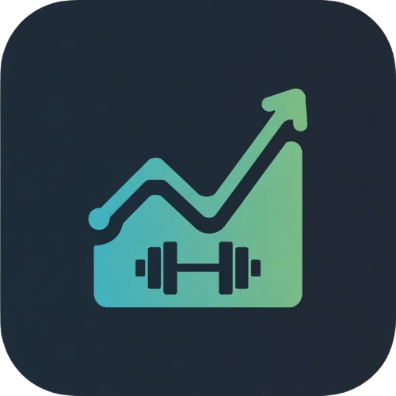
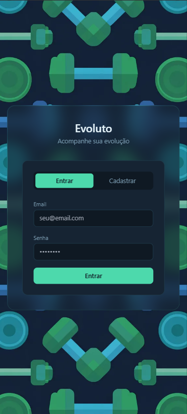
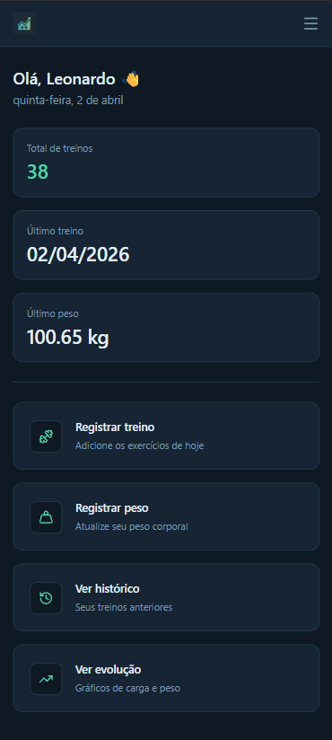
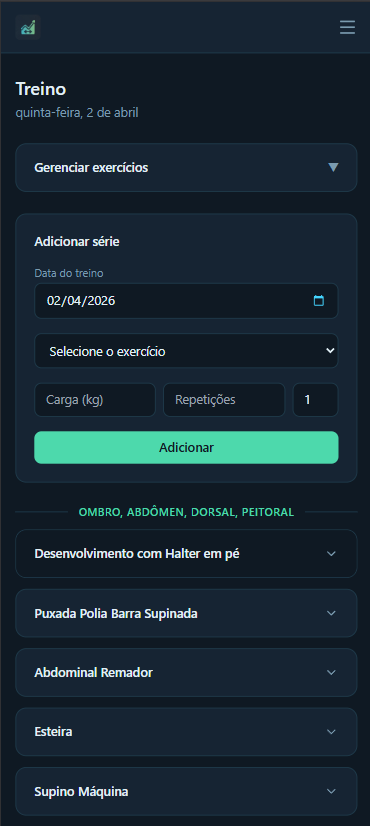
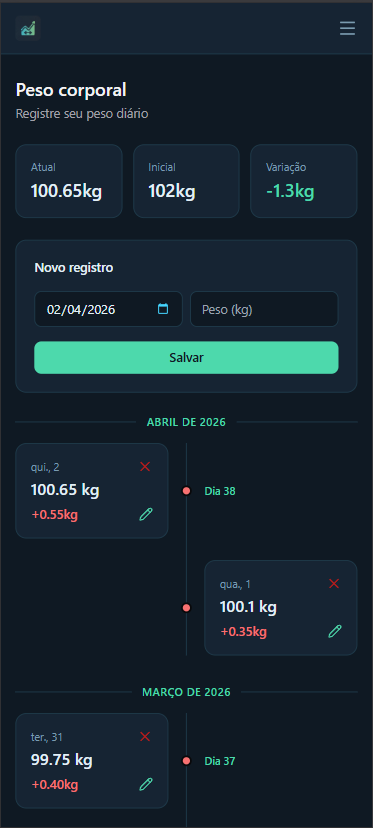
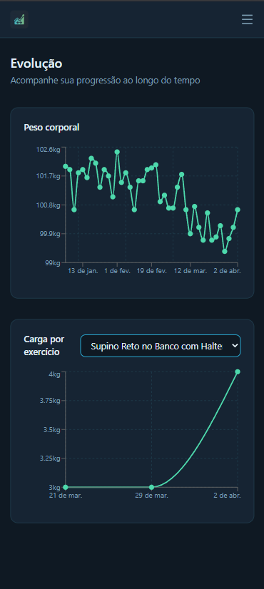
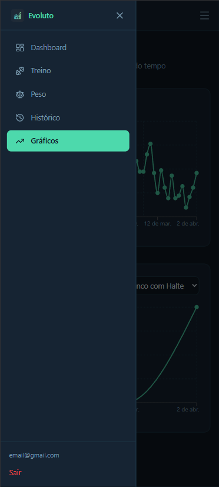

<div align="center">
  
  <h1>Evoluto</h1>
  <p>Acompanhe sua evolução na academia. Registre treinos, pesos e visualize seu progresso ao longo do tempo.</p>

  
  
  
  
</div>

---

## Screenshots

| Login | Dashboard | Treino |
|---|---|---|
|  |  |  |

| Peso | Gráficos | Mobile |
|---|---|---|
|  |  |  |

---

## Funcionalidades

### Treinos
- Registro de séries com carga e repetições
- Suporte a exercícios de **força** e **cardio** (duração + distância)
- Gerenciamento de exercícios agrupados por grupo muscular
- Adição de múltiplas séries de uma vez
- Edição e exclusão de séries inline
- Visualização agrupada por grupo muscular

### Peso corporal
- Registro diário de peso
- Timeline mensal alternada com variação entre dias
- Contador de dias de treino por registro
- Cards de resumo: peso atual, inicial e variação total

### Evolução
- Gráfico de peso corporal ao longo do tempo
- Gráfico de carga máxima por exercício de força
- Gráfico de duração por exercício de cardio

### Histórico
- Últimos 20 treinos com exercícios e séries
- Agrupamento por grupo muscular
- Exibe treinos sem séries cadastradas

---

## Tecnologias

| Camada | Tecnologia |
|---|---|
| Frontend | React 19 + TypeScript + Vite |
| Estilização | Tailwind CSS v3 |
| Backend | Supabase (PostgreSQL + Auth + RLS) |
| Gráficos | Recharts |
| Ícones | Lucide React |
| Notificações | React Hot Toast |
| Deploy | Vercel |

---

## Arquitetura
```
Celular / PC
     ↓
React (Vercel)
     ↓
Supabase (PostgreSQL + Auth)
```

O frontend consome o Supabase diretamente via SDK para operações de CRUD. A segurança é garantida pelo **Row Level Security (RLS)** — cada usuário acessa apenas seus próprios dados.

---

## Estrutura do banco
```sql
grupos_musculares   -- Peito, Costas, Ombro...
exercicios          -- nome, tipo (forca|cardio), grupo_muscular_id
registros_treino    -- data do treino
series              -- carga/repeticoes ou duracao/distancia
registros_peso      -- peso_kg por data
```

---

## Como rodar localmente

### Pré-requisitos

- Node.js 22+
- Conta no [Supabase](https://supabase.com)

### Instalação
```bash
# Clone o repositório
git clone https://github.com/seu-usuario/evoluto.git
cd evoluto

# Instale as dependências
npm install

# Configure as variáveis de ambiente
cp .env.example .env
```

Preencha o `.env` com suas credenciais do Supabase:
```env
VITE_SUPABASE_URL=https://xxxxxxxxxxxx.supabase.co
VITE_SUPABASE_ANON_KEY=sua_anon_key_aqui
```
```bash
# Rode o projeto
npm run dev

# Para acessar pelo celular na mesma rede Wi-Fi
npm run dev -- --host
```

### Banco de dados

Execute os scripts SQL na ordem abaixo no **Supabase → SQL Editor**:

1. Criação das tabelas (`grupos_musculares`, `exercicios`, `registros_treino`, `series`, `registros_peso`)
2. Habilitação do RLS e criação das policies
3. Inserção dos grupos musculares padrão

---

## Deploy

O projeto usa deploy contínuo via Vercel. A cada `git push` na branch `main` um novo deploy é gerado automaticamente.

Configure as variáveis de ambiente em **Vercel → Settings → Environment Variables**:
```
VITE_SUPABASE_URL
VITE_SUPABASE_ANON_KEY
```

---

## Paleta de cores

| Variável | Hex | Uso |
|---|---|---|
| `--fundo` | `#0f1923` | Fundo da página |
| `--card` | `#162433` | Cards e containers |
| `--borda` | `#1e3a4a` | Bordas |
| `--destaque` | `#4dd9ac` | Destaque principal |
| `--azul` | `#2bb5e0` | Destaque secundário |
| `--texto` | `#e2f0f7` | Texto principal |
| `--texto-muted` | `#7a9bb0` | Texto secundário |

---

## Licença

Este projeto é de uso pessoal.